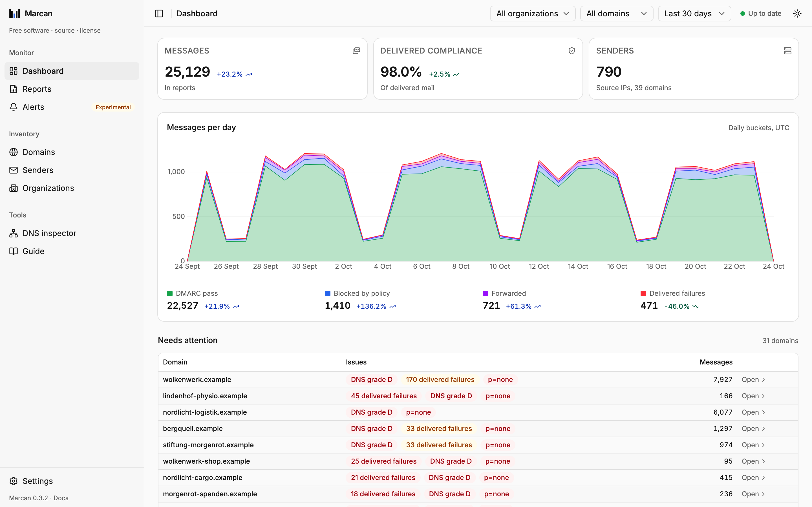

# Marcan

**Self-hosted DMARC report processing and mail security monitoring.**

Marcan reads DMARC aggregate reports from an IMAP mailbox, checks your domains' SPF, DKIM and DMARC records live, and shows the results in a web dashboard. It is one Rust binary with the UI built in, and it keeps everything in one SQLite file.

**Documentation: <https://marcan.kaitiaki.tech/>**

<picture>
  <source media="(prefers-color-scheme: dark)" srcset="docs/public/screenshots/dashboard-dark.png">
  
</picture>

> **Public beta (0.x).** Expect rough edges, and back up your database before upgrading: the schema may still change.

## Features

- **Its own alignment checks.** Recomputes SPF and DKIM alignment (RFC 7489) for every record with the Public Suffix List instead of trusting each reporter's verdict.
- **Forwarding-aware.** Splits failures into blocked by policy, forwarded (the receiver trusted the forwarder) and real delivered failures, so mailing lists are not mistaken for spoofing.
- **An attention list ranked by severity**, not by mail volume, so problems on small domains are not hidden.
- **Live DNS checks** for DMARC, SPF (full include tree and lookup limit), DKIM, MTA-STS, TLS-RPT and BIMI, with a 0–100 DNS score. A check that fails never replaces the last good result.
- **DKIM coverage**: how much of your passing mail is signed by your own domain, not passing on SPF alone.
- **Sender identity from evidence**: names senders from forward-confirmed reverse DNS and SPF, with your own names on top. No guessed IP range lists.
- **Organizations, parked and ignored domains**, all editable as one CSV list.
- **Alerts on changes** (experimental), never on a state that persists: DNS records and the DMARC policy, health, failing mail reaching inboxes, reports stopping, readiness for the next policy step, a domain marked as parked, by email with an optional digest.
- **Monthly client reports** (experimental): a short email per organization about its own domains, to the recipients you list: a verdict, the month's mail against the month before, and a few lines only for the domains with something to say (open issues, the next policy step, a failing DNS grade, what changed). Your name and logo in the letterhead, free for everyone: under Marcan's line, the logo at most 120×32 px; with an [operator key](https://marcan.kaitiaki.tech/license#what-a-key-changes), your letterhead alone.
- **CSV exports** of domains, senders, authentication issues and DNS findings.
- **Read-only on your mailbox.** It never moves, flags or deletes mail.

## Quickstart

Try it on your own machine:

```bash
docker run --rm -p 127.0.0.1:8080:8080 -v marcan-data:/data ghcr.io/mavgit1/marcan:latest
```

Open <http://localhost:8080> and follow the setup. Keep the `127.0.0.1:` in `-p`: without it, anyone on your network can open Marcan. To reach it from other machines, run it behind a reverse proxy with a login: `deploy/` has ready-made stacks, one folder each. Like the command above, they keep the database in a named Docker volume; a directory on the host works too, but is slower on Docker Desktop and some NAS filesystems.

## Security

Marcan has no user accounts of its own: the login comes from the reverse proxy in front of it, from a shared password to single sign-on with two-factor authentication. `deploy/` has ready-made Docker Compose stacks: `caddy/` (basic auth), `authelia/` and `oauth2-proxy/`. Marcan must only ever be reachable through that proxy; see [Deployment](https://marcan.kaitiaki.tech/deployment) and [Security model](https://marcan.kaitiaki.tech/security).

## Limitations

- One IMAP mailbox and folder, TLS or STARTTLS, password login.
- Microsoft 365 / Exchange Online mailboxes cannot connect (no OAuth2).
- Aggregate reports only.

See the [roadmap](https://marcan.kaitiaki.tech/roadmap) for what is planned.

## Development

```bash
scripts/check.sh   # formatting, tests, lints, UI checks
```

See [Development](https://marcan.kaitiaki.tech/development) for running it locally and the project layout.

## License

**Free for your own domains.** Running Marcan for clients, including administering it on a client's own server? Tell them it is software they could run themselves, or buy a license that exempts you. All of the code is here either way; nothing is held back for a paid edition.

Licensed under the [Beneficiary Copyleft License 1.0](LICENSE) (the AGPLv3 in [`AGPL-3.0.txt`](AGPL-3.0.txt) plus that notice duty, under Swiss law). See [License](https://marcan.kaitiaki.tech/license) and [Pricing](https://marcan.kaitiaki.tech/pricing). Contributions are welcome under the terms in [CONTRIBUTING.md](CONTRIBUTING.md).

Third-party data in `crates/dmarc-identity/data/` keeps its own licenses (see the README there).
